<div align="center">

<picture>
  <source media="(prefers-color-scheme: dark)" srcset="assets/banner-dark.svg">
  
</picture>

<br>


**One command to drive desktop apps and websites from an AI agent.**<br>
macOS · Windows · Linux · Web, one interface, automatic fallback.

</div>

---

Agents are great at text and clumsy with GUIs, mostly because every GUI driver has
its own quirks. `desk` is a tiny **router** (one file, standard library only) that
puts the best drivers behind one boring, predictable interface and falls back on
its own when one of them can't do the job.

It isn't another automation framework. It's the glue that lets an agent use the
existing ones without learning four different CLIs.

<picture>
  <source media="(prefers-color-scheme: dark)" srcset="assets/routing-dark.svg">
  
</picture>

## Why agents like it

|  |  |
|---|---|
| **One JSON line per command** | `{"ok": true, "route": "agent-desktop", …}` is easy to parse and easy to log, and it always says *which* driver did the work. |
| **No accidental double clicks** | `desk` only tries the next driver when the previous one provably did *not* deliver. A timeout, an unverifiable click or a suspected no-op comes back as `uncertain: true` instead of being replayed. Web clicks and fills never jump to a second browser. Read the state first, then decide. |
| **Same commands everywhere** | `desk click --app … --name …` reads the same on macOS, Windows and Linux. The drivers handle AX, UIA and AT-SPI underneath. |
| **Unicode-proof app names** | Names with soft hyphens (`System­einstellungen`) or odd casing still match, because they are NFC-normalized and case-folded first. |
| **Sticky browser sessions** | The browser that opened a page stays in front for later steps, so element refs stay valid. |
| **No Python dependencies** | One file, standard library only. You bring the drivers you want to use. |

## Platforms

<picture>
  <source media="(prefers-color-scheme: dark)" srcset="assets/platforms-dark.svg">
  
</picture>

macOS is what desk is used on every day. Windows and Linux are supported in the code and by the drivers, but haven't been tested end to end yet. Reports are very welcome.

`desk` looks for each driver in `~/.local/bin` first (including `.exe` and `.cmd`
on Windows), then on your `PATH`. You only need the drivers you actually use:

| Driver | Used for | macOS | Windows | Linux |
|---|---|:---:|:---:|:---:|
| [agent-desktop](https://github.com/vercel-labs/agent-desktop) | desktop apps (primary) | ✓ | ✓ | ✓ |
| [cua-driver](https://github.com/trycua/cua) | desktop apps (fallback, screenshots) | ✓ | ✓ | ✓ |
| agent-browser | web (primary) | ✓ | ✓ | ✓ |
| playwright-cli | web (fallback) | ✓ | ✓ | ✓ |
| agent-reach | read-only platform content | ✓ | ✓ | ✓ |

## Install as a plugin

**Codex**

```bash
codex plugin marketplace add schenkei-code/desk
codex plugin add desk@desk
```

**Claude Code**

```
/plugin marketplace add schenkei-code/desk
/plugin install desk@desk
```

The plugin ships the `desk` skill and a bundled copy of `desk.py`, so the agent
knows the commands, the routing and the safety rules without any setup on your side.
You still need the drivers you want to use (see [Platforms](#platforms)).

## Install the CLI

**macOS / Linux**

```bash
git clone https://github.com/schenkei-code/desk.git
install -m 755 desk/desk.py ~/.local/bin/desk
```

**Windows** (PowerShell)

```powershell
git clone https://github.com/schenkei-code/desk.git
py desk\desk.py apps
```

On Windows, put a small `desk.cmd` on your `PATH` containing `@py "%~dp0desk.py" %*`
if you want to type `desk` directly.

**Permissions**

- **macOS:** give your terminal *Accessibility* and *Screen Recording* access in System Settings → Privacy & Security.
- **Windows:** run `desk` at the same integrity level as the app you drive. An elevated app needs an elevated terminal.
  Prefer the `.exe` builds of the drivers. If one is only installed as a `.cmd` shim, `desk` refuses arguments containing cmd.exe metacharacters (`& | < > ^ % ! "`), so nothing an agent types can turn into a shell command.
- **Linux:** turn on desktop accessibility so the AT-SPI bus is running. On GNOME: `gsettings set org.gnome.desktop.interface toolkit-accessibility true`. X11 sessions get the most complete coverage.

## Usage

```bash
desk apps                                              # running GUI apps
desk find  --app Notes --name "New Note" --role button
desk click --app Notes --name "New Note"
desk type  --app Notes --name "Body" --text "hello from an agent"
desk shot  --app Notes --out notes.png

desk web open https://news.ycombinator.com
desk web snapshot                                      # interactive elements with refs
desk web click @e12
desk web read https://example.com                      # agent-browser → agent-reach → playwright
desk reach read https://github.com/vercel-labs/agent-desktop

desk ad | cua | ab | pw | reach …                      # raw passthrough to each driver
```

The same commands work on Windows (`--app Notepad`) and Linux (`--app gedit`).
Every command exits `0` on success and prints a single JSON object:

```json
{"ok": true, "route": "cua-pixel", "effect": "delivered", "label": "Reload"}
```

| `route` | Meaning |
|---|---|
| `agent-desktop` | Found and acted on semantically, delivery confirmed |
| `cua` / `cua-ax` | Fallback through an accessibility element token |
| `cua-pixel` | Last resort after Cua *refused* the accessibility click: a click at the center of the element's frame |
| `agent-browser` / `playwright-cli` / `agent-reach` | Web route that handled the command |
| `none` | Nothing matched; the error says why |

Any result with `"uncertain": true` means the action may have landed. Don't repeat it blindly.

## Limits (on purpose)

- A locked screen means no windows. None of the GUI drivers can see anything.
- `desk` never types passwords, logs in or buys things. That's a job for a human.
- It's a router. Coverage on each OS is whatever the drivers underneath support.

## Design

The artwork in `assets/` follows Emil Kowalski's design-engineering rules: a quiet
monochrome palette, hairline borders, soft layered shadows, and motion only where
it explains something. Results stack like [Sonner](https://sonner.emilkowal.ski)
toasts (`ease`, 400ms), the routing path animates with a strong ease-in-out, and
everything enters with a short 50ms stagger. Each image ships in a light and a dark
version that follows your GitHub theme, and it all stops moving under
`prefers-reduced-motion`.

## License

MIT
